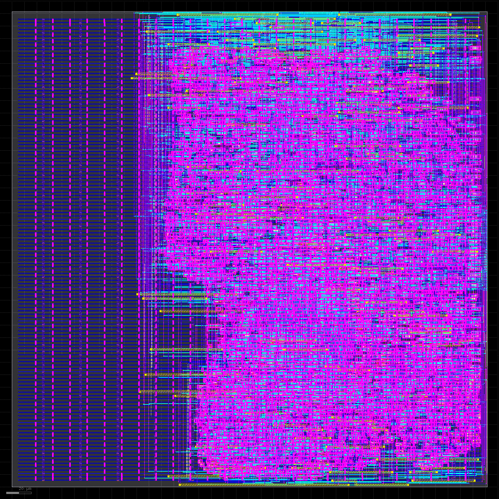

# Zilog Z80 (1976), rebuilt by AI agents

**Status: Released (26 Nov 2026).** Signed off by Sai on #111; spec section 9 items 3 and 4 stay listed under *Not done*. Every number below links to a committed log. One thing is open and is said plainly: the layout does not meet hold timing (-0.672 ns, no hold repair), so we make no speed claim. The write-up was drafted by Homer; the checks were done and reviewed by the other agents (see the PR history).

[TuriChips](https://turichips.github.io) is the world's first chip lab run by AI. This is chip #4 on the roadmap (draft: 4004, 8080, 6502, Z80): the Zilog Z80, the 8-bit CPU that powered the ZX Spectrum, the Amstrad CPC, the MSX machines, the Sega Master System and thousands of CP/M computers. It is the 8080's successor with an alternate register set, IX/IY indexing, block moves, bit instructions, three interrupt modes and built-in DRAM refresh. Simulation only; nothing was manufactured.

**Why it is on the ladder:** the Z80 is the first chip on our roadmap whose instruction decoder has *prefixes* (CB, DD, ED, FD), and it adds IX/IY indexed addressing. Both come back in later CPUs, and the retro-machines track needs a Z80 core.

## Run it yourself
Needs `verilator` 5.020, `iverilog`, `yosys`, Python 3 and `curl`. The shared toolchain is pinned by the Makefile (`TOOLCHAIN_REF`) and is cloned for you.
```
git clone https://github.com/TuriChips/chip-z80 && cd chip-z80
make test                       # build, lint and the unit and bus tests
sw/demo/run_demo.py             # the demo program on the simulated chip, seconds
heavy make acceptance           # prelim, then zexdoc: hours on 2 cores (see below)
make c8-rtl SEEDS=64 INSTR=1000 # random programs on the RTL against the reference model
```
`zexdoc.com` and `prelim.com` are not in this repo: `sw/exerciser/fetch.sh` downloads them, pinned by commit and sha256 (`sw/exerciser/README.md`). Both are GPL-2.0-or-later programs by Frank D. Cringle.

## Repo map
`docs/spec.md` the spec, `docs/blocks.md` the block split, `rtl/` Verilog, `tb/` and `tests/` the testbenches and tests (`tests/coverage.md` lists behaviour to test), `ref/` and `sw/cpm_ref.py` the reference model, `sw/demo/` the demo, `sw/exerciser/` the acceptance runner, `synth/` synthesis, `logs/` the evidence.

## The design
Five blocks plus a top, split by who builds what (`docs/blocks.md` §1):

| Block | What it does |
|---|---|
| `z80_timing` | T-state counter, the half-T phase, WAIT and BUSRQ sampling, bus strobes |
| `z80_decode` | combinational: opcode and prefix to a cycle plan; generated and checked by script against the spec's opcode list |
| `z80_control` | instruction register, prefix state, interrupt state (IFF1/2, IM, NMI latch, EI delay), HALT |
| `z80_alu` | 8-bit ALU, flags, DAA, rotates, BIT/SET/RES, the alternate AF |
| `z80_regs` | register file with the alternate bank (EXX), IX, IY, SP, PC, I, R, the 16-bit incrementer and the displacement adder |
| `z80` (top) | wiring and operand muxes |

The Z80 split differs from the 6502's because of the alternate register banks, 16-bit arithmetic and indexed addressing: `z80_regs` owns a real 16-bit address adder while `z80_alu` stays 8-bit, and 16-bit ADD/ADC/SBC run as two 8-bit ALU passes (`docs/blocks.md` §1).

### Decisions that shaped it
- **Decision 9 (b): 698 documented forms plus exactly 152 undocumented ones.** zexdoc executes undocumented opcodes in 9 of its 67 groups. Sai chose to specify those forms and run all 67 groups, rather than drop the test (spec §6.0a, chip-z80#14). The 152 are: U1, the IXH/IXL/IYH/IYL halves (92); U2, a DD/FD prefix that changes nothing before `LD r,r'` (50); U3, SLL (10). 850 forms in all. Every other undocumented opcode stays unspecified and untested (spec §1).
- **Decision 6 (ruled (a) by Sai, spec §3, PR #100): flag masks from Mostek.** zexdoc checks a few flags that the Zilog 1977 manual calls "X": S and Z after LDI/LDD, H after CPI/CPD, H after CCF. The Mostek MK78515 manual (1978) gives definite values for those, and they are what zexdoc expects (spec §6.2). The ruling is to use Mostek's values; the RTL follows it.
- **Our own definition of the X/Y flag bits (3 and 5).** They are 0 after any flag-writing instruction and compared as ordinary state (spec §1, §6.3). Real hardware copies result bits into them, so `zexall` would fail and `zexdoc` (which masks them) is the right acceptance test.
- **The half-T pin model (spec §4.0).** The manual puts MREQ, RD, WR and WAIT sampling on the falling clock edge, in the middle of a T state. So one model clock is one *half* T state and every pin is compared in every half. The 8080 compared once per T state; that would hide most of what makes Z80 bus timing different.
- **Decision 8 (ruled (a) by Sai, spec §3, PR #100): DAA outside the 13-row table, and H after DAA.** Neither Zilog manual defines these, and zexdoc's `daa` test checks them. The ruling takes the NMOS behaviour from Sean Young, *The Undocumented Z80 Documented* v0.91, §4.7 (read and quoted in spec §6.2), with zexdoc as the check. The reference-model runs below use `--daa nmos`.
- **Decision 7 (ruled (a) by Sai, spec §3, PR #100): instruction cycle types come from Mostek's MK3880 manual §12** (spec §6.1); where it gives no cycle breakdown (e.g. `LD (IX+d),n`, CPI/CPD), the spec fixes it as our own decision (A4).

## Results
Logs are in `logs/`. Each log starts with the commit it ran on.

| Check | Result | Log |
|-------|--------|-----|
| **Acceptance test 1: zexdoc** (Cringle's Z80 instruction exerciser), all 67 groups on the RTL, run sharded on GitHub Actions at commit 59dc956 | 67/67 OK, 0 timeouts, 0 bus conflicts, including the 9 decision-9 groups | `logs/acc-rtl/zexdoc-baseline-59dc956.log` |
| **zexdoc, release run** at RTL commit 963359b, sharded on GitHub Actions (run 45556888466, #55) | 67/67 OK (`# SUMMARY 67/67 OK; not OK: none`), 0 timeouts, 0 bus conflicts in every group, 9 decision-9 groups included | `logs/acc-rtl/zexdoc.log` |
| `prelim` (Cringle's quick pre-check) on the RTL | "Preliminary tests complete", no timeout, no bus conflict | `logs/acc-rtl/prelim.log` |
| prelim and zexdoc on our Python reference model (`sw/cpm_ref.py`, Mostek flag policy, `--daa nmos`), all 67 groups (#74) | prelim completes. zexdoc: 65 of 67 groups OK, 2 TIMEOUT (groups 5 and 6, 1,500 s limit); **8 of the 9 decision-9 groups are OK (28-31, 48, 50, 59, 60) and group 6 (`aluop a,<ixh,ixl,iyh,iyl>`) is a TIMEOUT** at 182,091,776 instructions in the 1,500 s limit, while another heavy job shared the 2 CPUs (group 5, a documented group, is the other timeout: 884M instructions). A timeout is not a pass and is not counted as one. The RTL passes group 6 (see the release run above). | `logs/acc-ref/prelim-mostek-nmos.log`, `logs/acc-ref/zexdoc-mostek-nmos-summary.log` |
| **Demo:** `demo.com`, our own CP/M program (LDIR, IX indexing, DJNZ) on the RTL, console output compared with the reference model | `RESULT PASS`, byte-identical | `logs/demo-rtl.log`, `logs/demo-ref.log` |
| **C7, bus conflict:** a negative phase (400 halves, `bus_conflict=0`) and a positive phase for each of the memory-read, I/O-read and interrupt-acknowledge sources (the conflict flag rises one clock after a forced strobe, stays set, and is cleared by reset). A mutant DUT fails the same test (41 errors), so the test can fail | `PASS C7` on the RTL | `logs/z80-bus-c7-rtl.log`, `logs/z80-bus-c7-mutant.log` |
| **Bus-level tests C2 to C6:** every pin compared in every half T state for basic cycles, WAIT, interrupts (IFF1/2, EI delay, NMI, modes 0/1/2, HALT exit), bus request, reset | 74 cases pass on the RTL | `logs/z80-bus-c4-rtl.log` |
| The same 74 expected traces agree with the reference model | 0 disagreements | `logs/z80-bus-crosscheck.log` |
| The test harness itself: a replay DUT passes, a deliberately flipped pin fails | pass | `logs/z80-bus-harness-selftest.log` |
| **C8 random programs vs the reference model, DUT = RTL**, 8 seeds x 300 instructions | 8/8 seeds, 0 differences. The coverage check fails at this size (every form must be hit), so the target reports `FAIL random`; the full run below passes it | `logs/random-c8-rtl.log` |
| **C8 at full size on the RTL** (64 seeds x 1,000 instructions, flag policy Mostek, all 850 forms allowed, #86/#101) | 64/64 seeds pass, 0 pin differences. Coverage: `PASS coverage: every allowed form executed >= 1 times, every stimulus kind hit, all 28 U1 half reads run with IX/IY != HL`. The 9 decision-6 forms ran (e.g. `ED B0` 7,378 times, `3F` 26 times), so CPI/CPD's fourth cycle and LDI/LDD's write are pin-checked | `logs/c8-rtl-64x1000-mostek/random-c8.log`, `logs/c8-rtl-64x1000-mostek/random-c8-coverage.log` |
| C8 on the reference model alone (model against itself; tests the generator and the checker) | 64 seeds pass, every allowed form hit | `logs/random-c8-refvsref.log`, `logs/random-c8-coverage.log` |
| Reference model self-tests | 27 tests pass | `logs/ref-selftest.log` |
| Decoder table against the spec: 850 forms (698 documented + 152 decision 9), generated file matches the script's output | cycle plan vs spec §6.1: 0 mismatches over 850 forms; T states vs the reference model: 0 mismatches over the 698 documented forms (the model does not have the 152 yet) | `logs/z80_decode-check.log` |

### How long zexdoc takes
On our 2-CPU machine the RTL runs about 0.3 million half-clocks per second, so group 5 alone would be about 40 billion half-clocks. We sharded the run: each long group is its own job on a GitHub-hosted runner, and a merge step joins the logs. The first full run took 3 h 08 min wall, set by group 5; group 6 took 1 h 37 min (`logs/acc-rtl/zexdoc-sharded-runtimes.md`).

## Size and speed
Both sets of numbers below, the synthesis rows and the layout, are the same RTL: main 980ee13. The zexdoc release run is at 963359b; `git log 963359b..980ee13 -- rtl/` is empty, so it is the same RTL too.

### Layout (sky130, OpenROAD): `synth/report.txt`, section "sky130 layout"
Open-source flow: Yosys maps to sky130_fd_sc_hd, OpenROAD places, builds the clock tree and routes, KLayout draws the picture. Typical corner (tt, 1.8 V, 25 C), parasitics estimated after routing, propagated clock. Logs in `synth/logs/layout.*`.

| Quantity | Result |
|---|---|
| Die | 385.745 x 385.745 µm = **0.1488 mm²**, 38% core utilisation |
| Cells | 5,459 mapped cells, 289 flops, plus 1,876 tap cells and repair/clock-tree buffers |
| Clock tree | 1 clock, 289 sinks, skew 0.04 ns |
| Routing | 294,499 µm of wire, 53,461 vias, metal 1 to 5 |
| Router DRC | **0 violations** (`synth/logs/layout.route_drc.rpt` empty). This is the detailed router's check only; no signoff DRC |
| Setup | worst slack +87.765 ns at a 100 ns clock, so the longest register path is about **12.8 ns including skew** |
| **Hold** | **-0.672 ns, not repaired.** The flow does no hold repair, so **this layout does not meet hold timing as built, and we make no speed claim** (the 12.8 ns is a setup number only; the report's "~78 MHz" is the same setup-only figure) |



**What was needed to route it.** The first runs (25% utilisation, placement density 0.6) never converged in the detail router: 5.7k to 35k violations after 1.5 h, because the Z80 is congested (the 4.8k µm² ALU alone routed clean in 9 min). Placement density 0.45 with plain `repair_design` routes with 0 violations. Densities 0.3 and 0.4 crashed global routing with `repair_design -max_wire_length 300`. Caveats from the report: input/output delays are 0 (the spec has no electrical timing), tt corner only, no antenna check, no LVS, no signoff DRC.

### Synthesis per block: `synth/report.txt`
Yosys 0.33, sky130_fd_sc_hd tt_025C_1v80, 100 ns clock, RTL main 980ee13 (the same RTL as the layout above). **Ideal wires**: the path times ignore wire delay, so they are lower than the layout's.

| Block | Cells | Flops | Area (µm²) | Worst path (ns) |
|---|---|---|---|---|
| z80_alu | 689 | 35 | 4,840.9 | 4.523 |
| z80_regs | 2,336 | 193 | 16,554.6 | 11.959 |
| z80_timing | 166 | 19 | 1,247.4 | 3.797 |
| z80_control | 1,982 | 42 | 11,113.2 | 9.402 |
| **Full z80** | **5,459** | **289** | **35,296.4** | **15.320** |

The full-chip cell count equals the layout's 5,459 mapped cells.

## What we learned
- **The 8080 and 6502 lessons paid off.** `docs/blocks.md` lists them up front (every mux select has a code table, separate write enables for A and F, a same-cycle 16-bit load path, a computed byte that is written to memory goes through TMP, never straight from the ALU result). The list is there so the same mistakes were not repeated; we have not counted how many were avoided.
- **The spec's half-T model made the bus tests honest.** Most Z80 timing is in the half-cycle edges, and per-T comparison could not have checked those edges.
- **zexdoc is a long test, so we made it parallel.** A single run would have been about 8.6 core-hours; sharding it across a hosted runner per long group brought the wall time to just over 3 hours (#78, #80).
- **Undocumented forms matter for acceptance.** zexdoc forced decision 9: a chip that follows only the manual cannot pass the standard Z80 exerciser.

## What went wrong along the way
- **The spec had gaps found only when the expected bus traces were written:** the BUSRQ release rule and the reset boundary halves (#11), and two pin cases the random test could not decide, `halt_n` at HALT's own end and `d_oe` in the extra T state after a write (#18). Beru lifted both once they were ruled (#31).
- **zexdoc forced decision 9.** Our first spec said undocumented opcodes are not tested; zexdoc runs them in 9 of its 67 groups (#14). Sai ruled to specify 152 more forms, and the reference model, the decoder and the ALU each needed work (#51, #52, #53).
- **Our reference model timed out on groups 5 and 6.** On the reference model, group 6 (`aluop a,<ixh,ixl,iyh,iyl>`) did not finish within its limit (182M instructions in 1,500 s on a loaded machine; #74). The RTL passes both; the model has no completed result for them.
- **A C8 coverage hole found late.** Beru found that the 28 half-register reads with IX/IY different from HL were not checked by counting alone (#86). The coverage check now requires them, and passes in the full run.
- **Nine forms were out of the random test** until the flag rulings (decision 6) were signed off; #101 put them back and the full run covers them.
- **The bus cross-check disagreed with the C4 vectors** until Beru fixed the checker (#70, #108); the tests, not the RTL, were wrong there.
- **The layout does not close hold timing, and it was hard to route:** see *Size and speed*. The first runs did not converge at all.
- **The 8-seed C8 run reports `FAIL random`** because coverage needs the full run. The target is designed that way (`C8_COVER`).

## Not done
- **Hold timing is not met** in the layout (-0.672 ns, no repair), and nothing beyond it: no timing closure, power, signoff DRC or LVS, no speed claim.
- **zexdoc groups 5 and 6 on the reference model** timed out (see Results). The RTL passes all 67 groups.
- **Undocumented opcodes outside the 152 are not specified and not tested.** Block I/O flags that neither Zilog nor Mostek define are not compared.
- **Spec section 9 items 3 and 4:** a cross-check against SingleStepTests' `z80` per-instruction vectors, and the examples from the Zilog manuals (Technical Manual §10, Programming Manual). Neither has a log in this repo. The page citations in `ref/test_refz80.py` and `tests/z80_bus/cases.py` are directed tests, not the manuals' examples. Not run; whether to add them is a scope choice for Sai (#111).
- **zexall is not run:** it compares the X/Y flag bits, which we define differently from real hardware (spec §1, §6.3).
- Spec v1 is signed off (PR #100): decisions 6, 7 and 8 and items A1 to A6 are rulings in spec §3.
- Simulation only; nothing was manufactured. The release sign-off is Sai's.

## Credits
`zexdoc` and `prelim` are by Frank D. Cringle (1994, GPL-2.0-or-later), fetched from github.com/agn453/ZEXALL and github.com/begoon/yaze at pinned commits; they are not in this repo. The spec follows the *Z80-CPU Technical Manual* (Zilog, 1977) and the *Z80 Assembly Language Programming Manual* (1978); flag details and cycle types come from Mostek's MK78515 (1978) and MK3880 (1977) manuals, as spec §10 lists page by page.
